# asciigraph

Drawing liberally on the excellent work by Lewis Hemens in his development of
[ASCIIFlow](https://github.com/lewish/asciiflow), ASCIIGraph is a new style of editor entirely.
While ASCIIFlow focused very specifically on editing of characters, ASCIIGraph treats individual
elements as objects that can be connected and moved.

ASCIIGraph is a diagram editor whose output is explicitly plain text.  This allows those diagrams
to be placed directly into code blocks as documentation, or within Markdown documents.  The beauty
of ASCIIGraph is that you can simply draw boxes and connect them. The connectors stay attached and
reroute as you move things.

You can also express graphs and message sequence diagrams as text, and have ASCIIGraph
auto-generate a result.  You can then move and reposition objects, lines, and arrows.

You can then export the result as Unicode box drawing or plain ASCII, ready to paste into a README,
a code comment, a commit message or a chat.

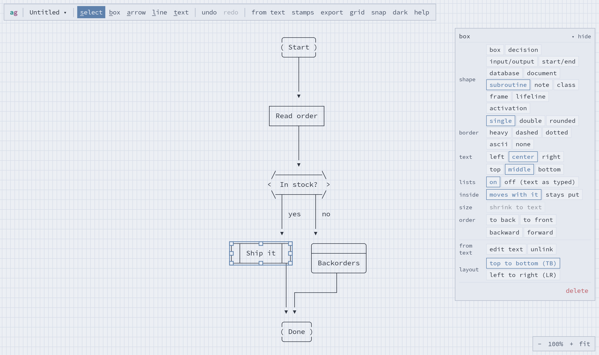

Here is what a sample textual export looks like, for a diagram drawn from four lines of Mermaid
(`A[Browser] -->|HTTPS| B[API]` …):

```
                                      ┌─┬────────┬─┐
                                   ┌┈►│ │ Worker │ │
                                   ┊  └─┴────────┴─┘
┌─────────┐          ┌─────┐       ┊ events
│ Browser ├─ HTTPS ─►│ API ├─────┬┈┘
└─────────┘          └─────┘     │     ╭──────────╮
                                 │     ├──────────┤
                                 └────►│ Database │
                                       ╰──────────╯
```

## Features

- **Objects, not characters.** Boxes, labels and connectors are things you move, resize and
  restyle. Connectors route around other boxes and follow the boxes to which they're attached.
- **Shapes:** Boxes with eight border styles, named boxes, flowchart shapes (decision,
  input/output, start/end, database, document, subroutine), notes, frames, class boxes in
  compartments, and sequence-diagram lifelines and activation bars.
- **Connectors:** Six line styles; a head at either end (arrow, hollow arrow, diamond, hollow
  diamond, dot, circle, cross, bar); labels; bend points; and a turn point you can drag.
- **Draw from text:** [Mermaid](https://mermaid.js.org/)
  [sequence diagrams](https://mermaid.js.org/syntax/sequenceDiagram.html),
  [flowcharts](https://mermaid.js.org/syntax/flowchart.html),
  [state diagrams](https://mermaid.js.org/syntax/stateDiagram.html),
  [class diagrams](https://mermaid.js.org/syntax/classDiagram.html) and
  [entity–relationship diagrams](https://mermaid.js.org/syntax/entityRelationshipDiagram.html), a looser shorthand
  (`Client -> API: GET /x`, `A -> B -> C`), and folder trees. The drawing stays linked to the
  text: edit the text and it redraws, keeping what you've moved or restyled. A hand-drawn diagram
  can be turned into Mermaid too.
- **Existing drawings:** paste a diagram someone drew as text (box-drawing characters or `+--+`
  ASCII) and it becomes boxes and connectors you can move. Sequence diagrams come back as
  lifelines and messages.
- **Arranging:** Snapping with guides, align and distribute, Auto Layout, locking boxes together,
  matching sizes, and shrinking a box to fit its text.
- **Stamps:** save a group of objects and insert it again in any diagram; share them as a file.
- **Markdown lists** in boxes: bullets, numbering, nesting, and wrapped lines that hang under the
  item.
- **Export:** Text (plain, a Markdown code block, or a comment block for C, Python, shell or your
  own style; Unicode or ASCII only), PNG and SVG pictures (light or dark), JSON, or a share link.
  Export the whole diagram or just the selection.
- **Command line:** draw text into text in scripts and build steps, or keep the drawings in a
  Markdown file up to date with the Mermaid beside them.
- **No server, no account.** Diagrams are kept in your browser, and undo history survives a
  reload.
- **Phones too:** The properties panel becomes a bottom sheet, and you can pinch to zoom.

## Running it

It runs in Docker, so it works the same way on Windows, Mac and Linux, on Intel or ARM (Apple
Silicon, Raspberry Pi). You need:

- **Windows or Mac:** [Docker Desktop](https://www.docker.com/products/docker-desktop/).
- **Linux:** [Docker Engine](https://docs.docker.com/engine/install/) with the compose plugin,
  or Podman (use `podman` in place of `docker` below).

Then, in a terminal (PowerShell on Windows):

```bash
git clone https://github.com/StevenTomer/asciigraph.git
cd asciigraph
docker compose up -d --build
```

Then open http://localhost:8080/. It keeps running in the background and restarts with Docker.
To stop it, run `docker compose down`. After pulling changes, run `docker compose up -d --build`
again to rebuild.

No Git? On GitHub, choose **Code → Download ZIP**, unzip it, and run `docker compose up -d --build`
in the unzipped folder (`asciigraph-master`).

### Choosing the port

It listens on port 8080 by default. To use another port, set `ASCIIGRAPH_PORT` when you start it.
By default it accepts connections from other machines too. To accept them only from this
machine, or on one network interface, put an IP address in front of the port (`127.0.0.1:3000`).

#### Mac and Linux

```bash
ASCIIGRAPH_PORT=3000 docker compose up -d --build            # http://localhost:3000/
ASCIIGRAPH_PORT=127.0.0.1:3000 docker compose up -d --build  # this machine only
```

The setting applies to that one command. Compose only reads it when it creates the container,
so include it each time you run `up`.

#### Windows (PowerShell)

```powershell
$env:ASCIIGRAPH_PORT="3000"; docker compose up -d --build            # http://localhost:3000/
$env:ASCIIGRAPH_PORT="127.0.0.1:3000"; docker compose up -d --build  # this machine only
```

The setting lasts until you close that PowerShell window, so set it again in a new one before
running `up`.

#### Any system: a `.env` file

To set the port once and for all, put it in a file named `.env` next to `compose.yaml`. Compose
reads it every time:

```
ASCIIGRAPH_PORT=3000
```

Without compose (the same on every system):

```bash
docker build -t asciigraph .
docker run -d -p 3000:8080 asciigraph               # or -p 127.0.0.1:3000:8080
```

Inside the container the app is always on port 8080, served by nginx, so only the left side of
`-p` changes.

Diagrams are saved in your browser (localStorage), not in the container. The container holds
no data, so you can rebuild or replace it without losing anything. But a diagram saved at
http://localhost:8080 isn't visible at another address (another host or port). To move one
across, export it as JSON or a share link.

## Command line

The same drawing works from the command line, for scripts, build steps and editors. Build the
command-line image once, from the asciigraph folder:

```bash
docker build --target cli -t asciigraph-cli .
```

Then, from any folder:

```bash
docker run --rm -v "$PWD:/data" asciigraph-cli flow.mmd          # draw a file
docker run --rm -v "$PWD:/data" asciigraph-cli flow.mmd --lr --ascii
docker run --rm -i asciigraph-cli < flow.mmd                     # or standard input
```

In Windows PowerShell, write `${PWD}` for `$PWD`, and pipe input in with
`Get-Content flow.mmd | docker run --rm -i asciigraph-cli`.

It reads Mermaid, the shorthand and folder trees, like **from text**, and also diagrams saved from
the app (**download .json**) and share links. What it can do:

- `asciigraph flow.mmd`: draw it. `--lr` or `--td` sets a graph's direction, `--boxes` draws a
  folder tree as boxes, `--ascii` uses ASCII only, and `--wrap markdown` (or `c-line`, `c-block`,
  `python`, `bash`) wraps it for pasting. `-o FILE` writes it to a file.
- `asciigraph markdown README.md --write`: after every ` ```mermaid ` block in a Markdown file,
  put its drawing in a ` ```text ` block. Run it again after editing the Mermaid and the drawings
  are updated in place. Without `--write` it prints the result.
- `asciigraph mermaid diagram.json`: write Mermaid for a diagram saved from the app, or for an
  existing drawing (`asciigraph mermaid old.txt`).
- `asciigraph import old.txt -o old.json`: read an existing drawing into a diagram the app can
  import, to edit it as objects.
- `asciigraph --help` lists everything.

On Linux, if it can't read or write your files ("permission denied"), run it as yourself: add
`--user "$(id -u):$(id -g)"` with Docker, or `--userns=keep-id` with Podman. Where SELinux is on
(Fedora, RHEL), also add `:Z` to the mount: `-v "$PWD:/data:Z"`. Docker Desktop on Windows and
Mac needs neither.

### Without Docker

With Node.js 22, in the asciigraph folder:

```bash
npm install
npm run build:cli        # makes cli/asciigraph.mjs, a single file with no dependencies
node cli/asciigraph.mjs flow.mmd
npm install -g .         # optional: puts asciigraph on your PATH
```

In Vim, select some Mermaid and run `:'<,'>!asciigraph` to replace it with its drawing.

## A quick tour

The full user guide is [docs/guide.md](docs/guide.md). The app's **help** button has a summary.

### Draw

Press <kbd>B</kbd> and drag to draw a box, then type. Press <kbd>A</kbd> and drag from one box
to another for an arrow (<kbd>L</kbd> for a line without a head). Press <kbd>T</kbd> and click
for a free label. After each one you're back in select mode: drag to move, pull the handles to
resize, double-click (or press <kbd>Enter</kbd> or <kbd>F2</kbd>) to edit the text. The
properties panel changes whatever is selected.

### Connector heads, and where connectors turn

Each end of a connector can have a head. A connector that steps across turns halfway between its
ends; select it and drag the middle stretch to turn somewhere else.

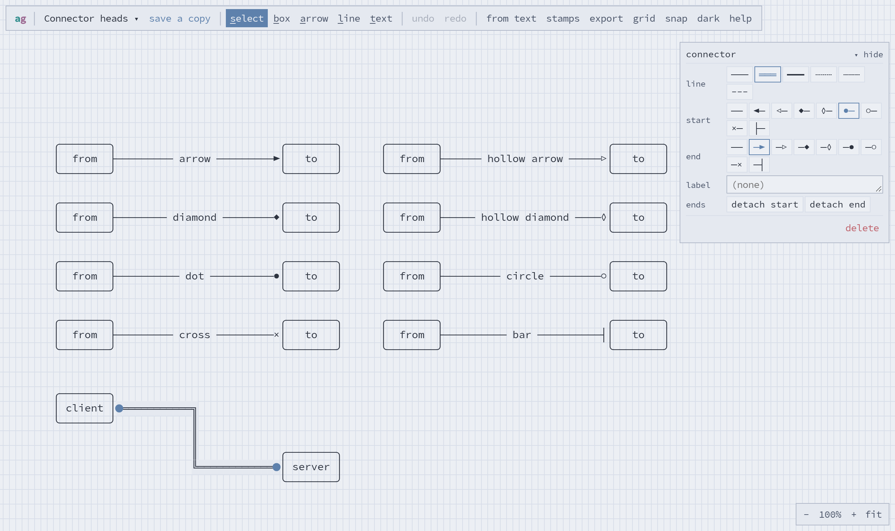

### Draw from text

**from text** in the toolbar takes Mermaid, a shorthand, or a folder tree, with a live preview.

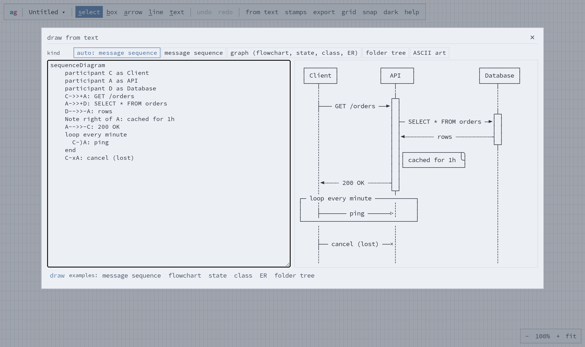

The drawing stays linked to its text. Select it and choose **edit text** to change it.

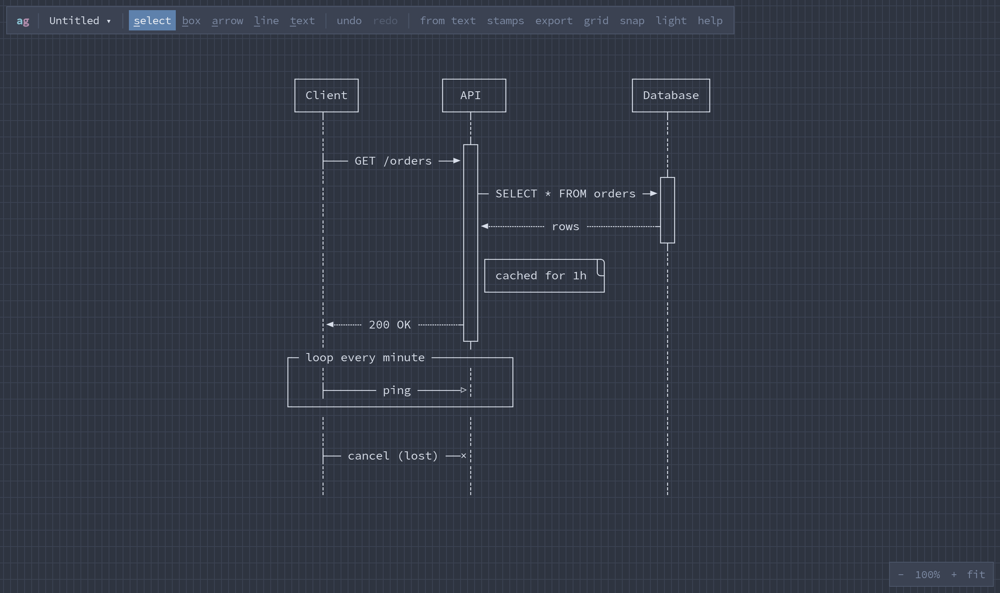

Folder trees can be drawn as boxes, as here, or as `tree`-style text.

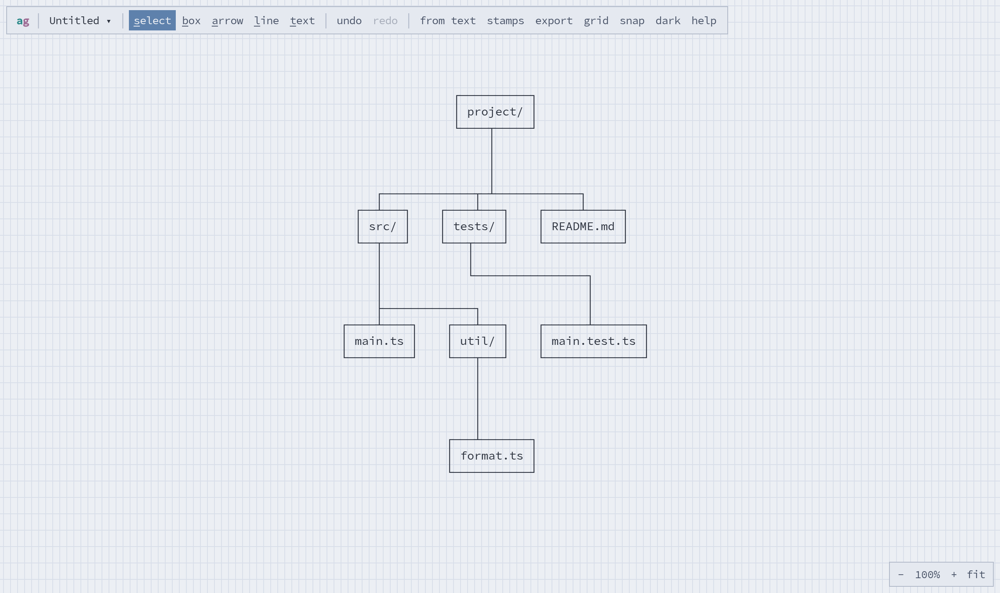

State, class and entity–relationship diagrams too:

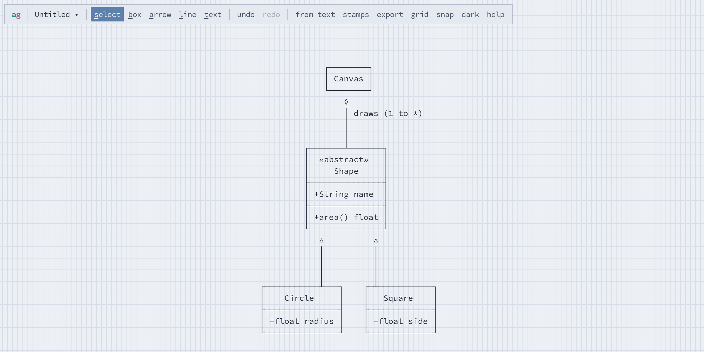

### Existing ASCII art

Paste a diagram someone drew as text, in box characters or `+--+` ASCII, and it becomes boxes
and connectors you can move and restyle.

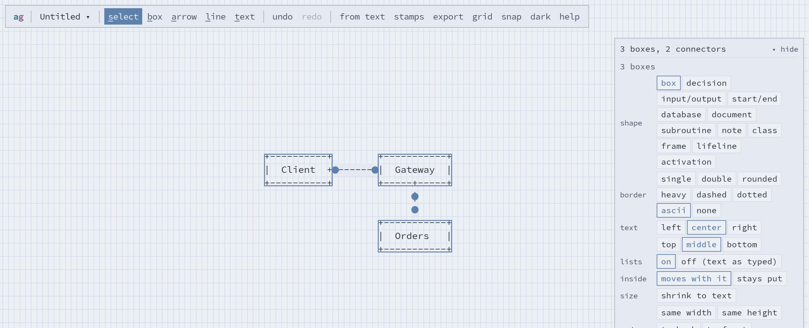

### Arrange

Right-click for what applies to the selection: cut, copy and duplicate; stacking order; Align,
Distribute and Normalize Size; Shrink to Text; Lock Together; Auto Layout.

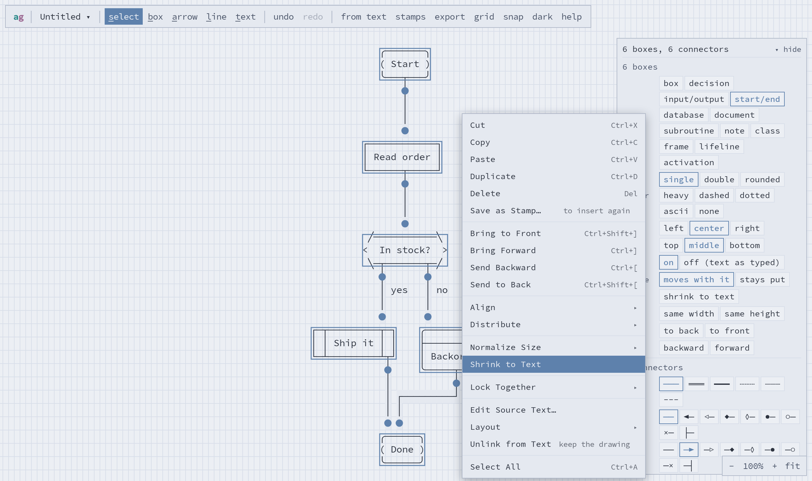

### Stamps

Save a selection as a stamp (right-click → **Save as Stamp…**) and insert it again, in any
diagram, from **stamps** in the toolbar. Export them to a file to share.

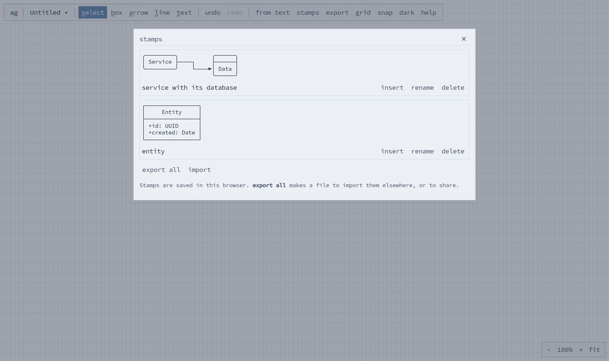

### Export

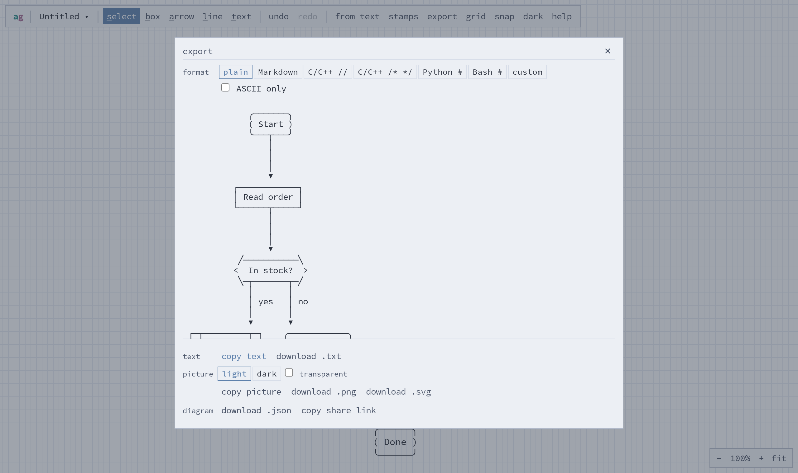

### On a phone

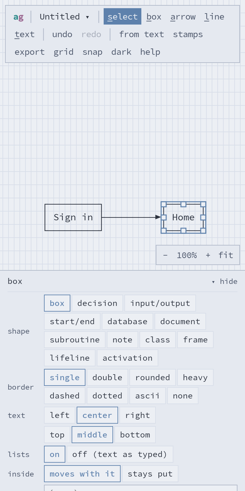

## How it compares

There are good tools for ASCII diagrams already. Most either let you draw by hand, or turn text
into a drawing once. asciigraph does both, and keeps the two linked.

|  | asciigraph | [Asciio](https://github.com/nkh/P5-App-Asciio) | [Monodraw](https://monodraw.helftone.com/) | [ASCIIFlow](https://asciiflow.com/) | Mermaid-to-ASCII tools |
|---|---|---|---|---|---|
| Runs on | any browser; locally in Docker | Linux desktop (Gtk3), and a terminal version | macOS | any browser | command line or library |
| Price | free, open source | free, open source | paid | free, open source | free, open source |
| You edit | objects | objects | objects | characters | text only |
| Connectors stay attached when boxes move | yes, and reroute around other boxes | yes | yes | no | — |
| Draw from Mermaid | yes, and stays linked: edit the text and it redraws, keeping your changes | not built in | not built in | no | yes, once |
| Turn a drawing into Mermaid | yes | not built in | not built in | no | no |
| Export | text (Unicode or ASCII, comment styles), PNG, SVG, JSON, share link | text, SVG (with goat) | text (comment styles), PNG, SVG | text | text |

**Asciio** is the closest open-source relative. Like asciigraph, it treats boxes and arrows as
objects, and its connections hold as you move things. It's a desktop and terminal app, driven
largely from the keyboard with vim-like bindings, and it has custom stencils (shape libraries)
and a command that builds a drawing from text. Choose it if you live in a terminal or in Vim.
asciigraph runs in a browser, on phones too, and works mostly with the mouse; its connectors find
their own way around other boxes, and it reads and writes Mermaid.

**Monodraw** is a polished Mac app with lines that attach to shapes, and much more besides
(a pencil, fill and eraser for freehand text art, and SVG export). It's the one to beat on a Mac, if you don't mind paying.

**ASCIIFlow** is where asciigraph started: its text rendering, input handling and fonts are
adapted here. It's a free hand-drawing tool that edits characters, so lines don't follow boxes.

**Mermaid-to-ASCII tools** such as
[mermaid-ascii](https://github.com/AlexanderGrooff/mermaid-ascii) and
[beautiful-mermaid](https://github.com/lukilabs/beautiful-mermaid) turn Mermaid into text in a
single step. They suit scripts and pipelines; to change the result, you change the text and
render it again.

## How it works

The document is objects, not characters. Nodes (boxes, labels) and edges (connectors) live in an
immutable `Diagram` (`src/model`). Every change re-renders the objects into a character grid:

1. connectors are routed (`src/routing`): each attached end finds its node's side, and an orthogonal
   router finds a path around other nodes;
2. everything is drawn as line strokes (directions per cell) and text into a `CharGrid`;
3. each cell's glyph is looked up from its directions, so junctions like `├ ┬ ┼` come out right.

That grid is what's on the canvas and what's exported, so the output is exactly what you see.
New node kinds (flowchart shapes, sequence-diagram lifelines…) plug in through `src/shapes`.

Drawing from text (`src/text`) parses the text, works out the objects it describes, and merges
them into the diagram. Each object is matched to its line of text, so your own moves and styles
survive a redraw.

Diagrams are saved in the browser (localStorage) behind a `DiagramRepository` interface
(`src/storage`), so a server-backed store can be added without changing the editor.

## Developing

Needs Node.js 22.

```bash
npm install
npm run dev          # http://localhost:5173
npm test             # unit tests (Vitest): rendering goldens, routing, ops, text parsing, sync
npm run e2e          # build, then Playwright (first time: npx playwright install chromium)
npm run build        # typecheck (strict) + production build into dist/ (what the image serves)
npm run build:cli    # the command line, into cli/asciigraph.mjs
npm run screenshots  # retake the pictures in docs/images
```

Rendering tests are golden text: build a diagram, render it, and compare it with the exact
drawing expected. The e2e tests drive the real app in Chromium. To run them against the
container, use `TEST_SERVER_PORT=8080 npx playwright test -c e2e/playwright.config.mjs`.

## Credits

Text rendering, input handling, the share-link format and fonts are adapted from
[ASCIIFlow](https://github.com/lewish/asciiflow) by Lewis Hemens (MIT). See `LICENSE`.
