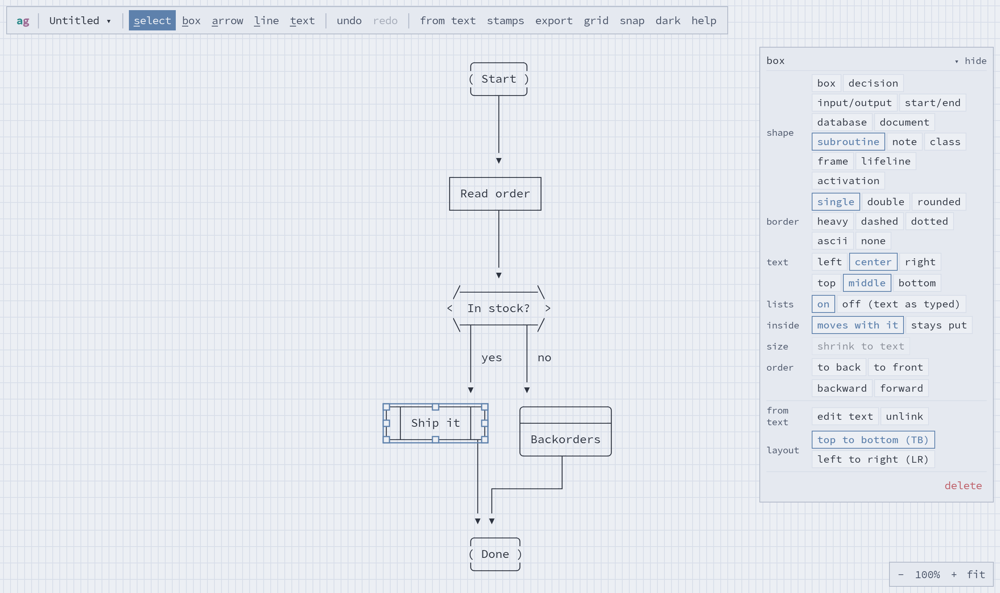
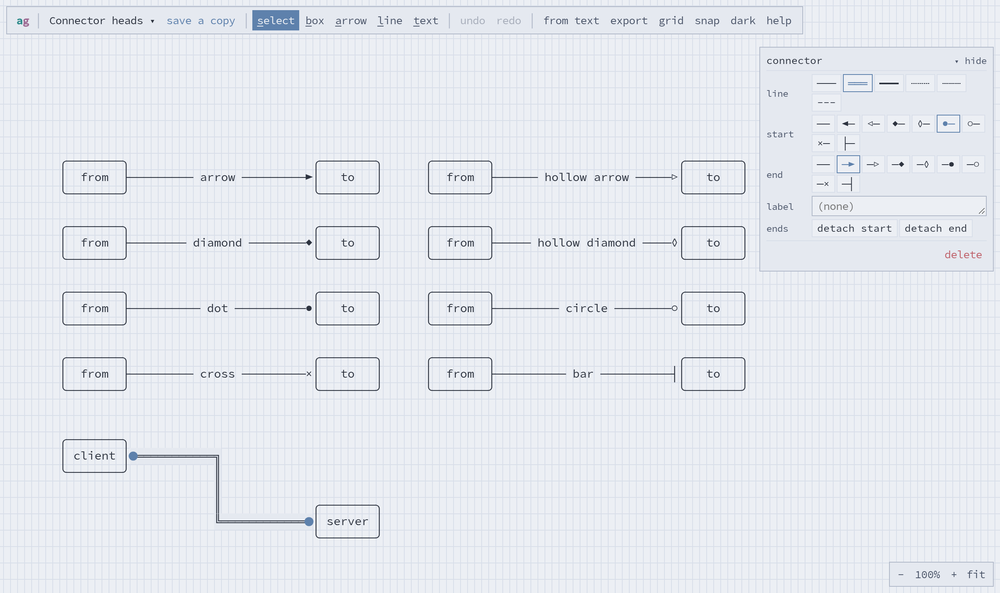
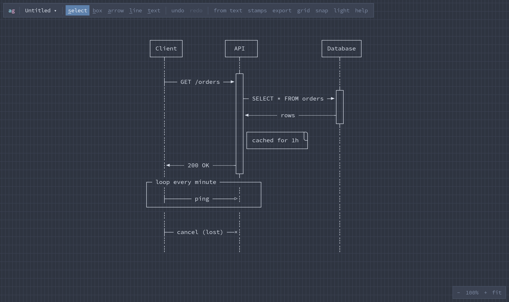
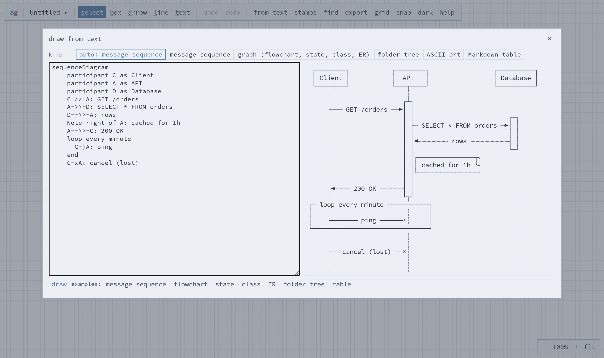
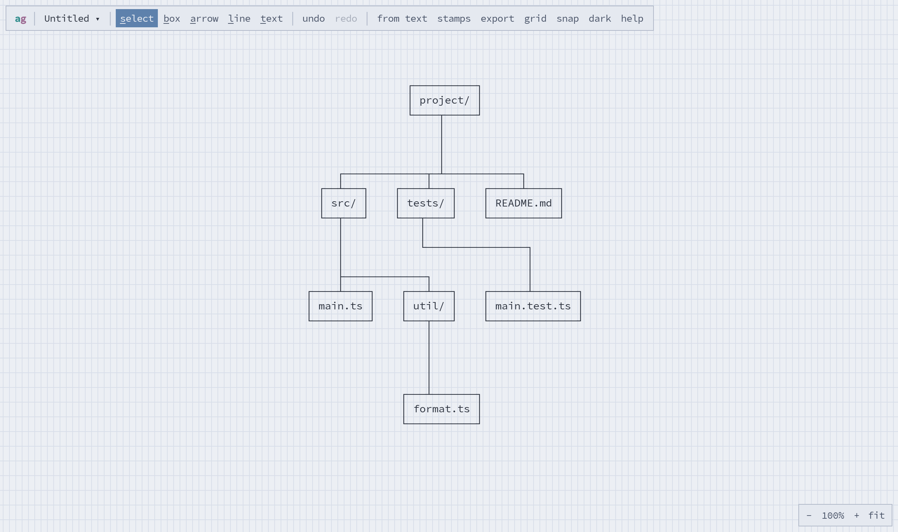
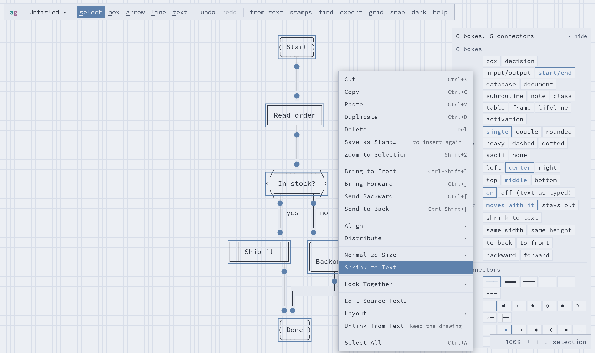
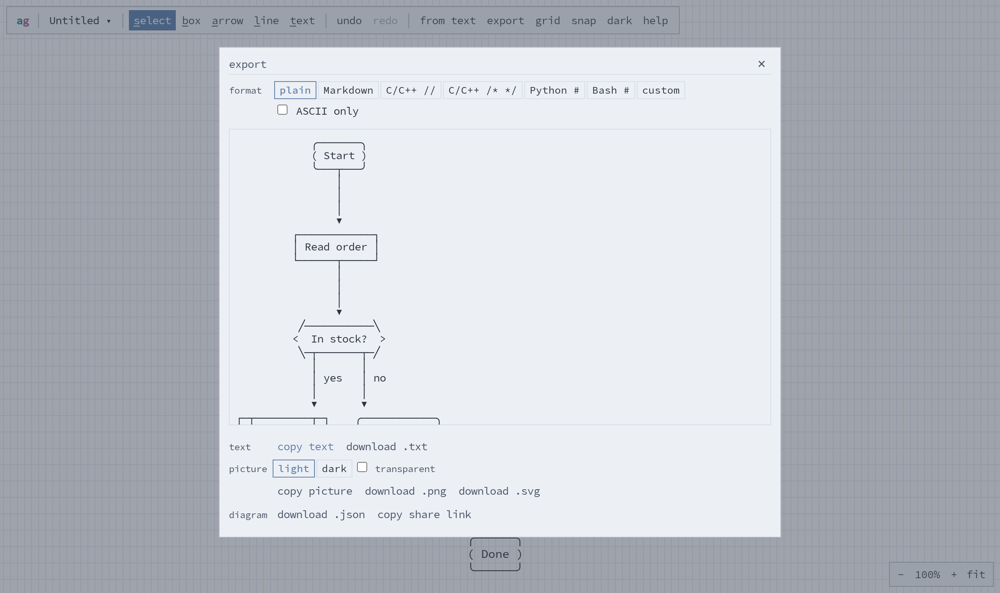
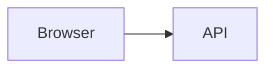
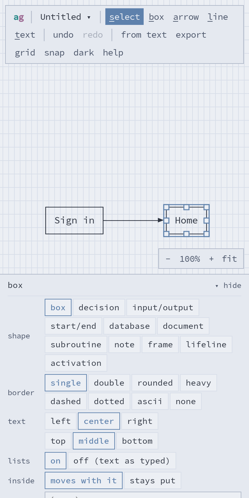

# asciigraph user guide

- [The screen](#the-screen)
- [Tools](#tools)
- [Selecting, moving and resizing](#selecting-moving-and-resizing)
- [Boxes and shapes](#boxes-and-shapes)
- [Text in boxes](#text-in-boxes)
- [Connectors](#connectors)
- [Sequence diagrams](#sequence-diagrams)
- [Drawing from text](#drawing-from-text)
- [Arranging](#arranging)
- [Saving, sharing and exporting](#saving-sharing-and-exporting)
- [The command line](#the-command-line)
- [Phones and tablets](#phones-and-tablets)
- [Keyboard shortcuts](#keyboard-shortcuts)

## The screen



- **Toolbar** (top): the diagram's name (click it for your list of diagrams), the tools, undo and
  redo, **from text**, **export**, and toggles for the **grid**, **snap** and **dark** mode.
  **help** gives a short summary of everything here.
- **Canvas**: the drawing, on a grid of character cells. Drag empty space with the middle mouse
  button, or hold <kbd>Space</kbd> and drag, to pan. Scroll to move around; <kbd>Ctrl</kbd> +
  scroll, or pinch, to zoom.
- **Properties panel** (right): the settings of whatever is selected. Changes apply to everything
  selected. Click its title bar to collapse it to a tab; that's remembered.
- **Zoom controls** (bottom right): zoom out and in, back to 100%, and **fit** to show the whole
  diagram.

## Tools

Each tool's shortcut is its first letter.

| Tool | Key | What it does |
|---|---|---|
| select | <kbd>S</kbd>, <kbd>Space</kbd>, <kbd>Esc</kbd> | Select, move, resize and edit. |
| box | <kbd>B</kbd> | Drag corner to corner, or click for a default-size box, then type. Pick the shape in the bar under the toolbar. |
| arrow | <kbd>A</kbd> | Drag from one box to another. Ends with an arrowhead. |
| line | <kbd>L</kbd> | The same, with no head. |
| text | <kbd>T</kbd> | Click to type a label without a border. |

After drawing a connector, or clicking away from a box or label you've just typed, you're back
in select mode with the new thing selected. To draw several boxes in a row, press <kbd>Esc</kbd>
when you finish typing each one instead: that keeps the box tool.

With a drawing tool, clicking an existing box or connector selects it (and goes to select mode),
so you rarely need to switch tools by hand. In box mode, dragging from inside a box draws a new
box inside it. In text mode, <kbd>Alt</kbd>+click places a label even on top of a box.

## Selecting, moving and resizing

- **Click** to select; <kbd>Shift</kbd>+click to add or remove. <kbd>Ctrl</kbd>+<kbd>A</kbd>
  selects everything.
- **Drag empty space** to draw a selection box. Inside a box or frame, hold <kbd>Ctrl</kbd> (or
  <kbd>⌘</kbd>) as you start dragging, otherwise you'd move the box.
- **Drag** a selection to move it, or nudge it with the arrow keys (<kbd>Shift</kbd>: 5 cells).
- **Handles** on a selected box resize it.
- **Boxes inside boxes:** a box entirely inside another is part of it. It's drawn in front, and
  moves when the outer box moves. <kbd>Alt</kbd>+drag moves just the outer box, or set **inside:
  stays put** on it.
- **Snapping:** moving, resizing or drawing a box lines its edges and center up with the boxes
  beside, above and below it, with guide lines. Hold <kbd>Alt</kbd>, press <kbd>Ctrl</kbd> while
  dragging, or turn **snap** off in the toolbar to place it freely.
- **Undo and redo:** <kbd>Ctrl</kbd>+<kbd>Z</kbd>, <kbd>Ctrl</kbd>+<kbd>Shift</kbd>+<kbd>Z</kbd>
  (or <kbd>Ctrl</kbd>+<kbd>Y</kbd>). The history is kept per diagram, and survives a reload.
- **Clipboard:** cut, copy and paste work as usual; <kbd>Ctrl</kbd>+<kbd>D</kbd> duplicates.
  Copying also puts the drawing on the clipboard as text, so you can paste it straight into
  another program.

## Boxes and shapes

Choose the shape before drawing (in the bar under the toolbar in box mode), or change it
afterwards in the properties panel.

| Shape | Looks like | For |
|---|---|---|
| box | `┌───┐` | anything |
| decision | `<  ok?  >` | flowchart branches |
| input/output | `╱ data ╱` | flowchart input and output |
| start/end | `( Start )` | flowchart terminals |
| database | `├──────┤` under a rounded top | data stores |
| document | a box with a wavy bottom | files, reports |
| subroutine | `│ │ Ship it │ │` | a predefined step |
| note | a box with a folded corner | comments |
| frame | a named box drawn behind things | grouping; boxes inside it aren't hidden |
| lifeline, activation | see [Sequence diagrams](#sequence-diagrams) | |

**Borders:** single, double, rounded, heavy, dashed, dotted, ASCII, or none. A box with no
border is a free label.

**Names:** double-click a box's top border to give it a name, drawn in the border (`┌─ API ──┐`).

**Sizes:** right-click → **Shrink to Text** makes a box the smallest size that shows its text
without wrapping. With several boxes selected, **Normalize Size** makes them all as wide and/or
as tall as the largest. Both are in the properties panel too (**size**).

**Stacking:** where boxes overlap, **to front / to back / forward / backward** in the panel or
the right-click menu changes which is on top (<kbd>Ctrl</kbd>+<kbd>]</kbd> /
<kbd>Ctrl</kbd>+<kbd>[</kbd>; add <kbd>Shift</kbd> to go all the way).

## Text in boxes

Double-click a box, or select it and press <kbd>Enter</kbd> or <kbd>F2</kbd>, to edit its text.
<kbd>Esc</kbd> or clicking outside finishes. Text wraps to the box's width. Set its alignment
(left, center, right; top, middle, bottom) in the properties panel.

**Lists:** lines starting `- `, `* ` or `+ ` become bullets, and `1. ` or `1) ` numbered items.
Indent to nest. Numbers renumber themselves, and wrapped lines hang under the item's text:

```
┌──────────────────────┐
│ Release:             │
│ • tag the version    │
│ • build the image    │
│   ◦ amd64            │
│   ◦ arm64            │
│ 1. publish           │
│ 2. announce it to    │
│    everyone          │
└──────────────────────┘
```

To keep one line as you typed it, put a backslash before the marker (`\- not a list`). To keep
all of a box's text as typed, set **lists: off** in the properties panel.

## Connectors

### Attaching

Draw a connector by dragging from one box to another. Start or end **inside** a box to attach to
whichever side faces the other end; start or end **on a border** (or just outside it) to pin
that exact spot. Hold <kbd>Alt</kbd> to leave an end free, not attached to anything.

Attached connectors follow their boxes, and route around other boxes on the way. To re-attach
one, select it and drag an end handle onto another box (or off into empty space to free it).
**detach start / detach end** in the panel frees an end where it is. Deleting a box frees the
connectors that were attached to it.

### Lines and heads

The properties panel sets the **line** (single, double, heavy, dashed, dotted, ASCII), and the
head at the **start** and at the **end**. The right-click menu has **Start Head** and **End
Head** too.



| Head | Unicode | ASCII export | Typical meaning |
|---|---|---|---|
| arrow | `►` | `>` | flow, a call |
| hollow arrow | `▷` | `>` | UML inheritance; an asynchronous message |
| diamond | `◆` | `#` | UML composition |
| hollow diamond | `◊` | `o` | UML aggregation |
| dot | `●` | `*` | a junction, a start point |
| circle | `○` | `o` | ER "zero or one"; optional |
| cross | `×` | `x` | a lost or failed message |
| bar | `┤` | `\|` | ER "exactly one"; blocked |

**Reverse Direction** (right-click) swaps the connector's ends, so its heads move to the other
boxes.

### Labels

Double-click a connector, or select it and press <kbd>Enter</kbd>, to label it.
<kbd>Shift</kbd>+<kbd>Enter</kbd> starts a new line. A label sits on the connector's longest
straight stretch (`── yes ──►`), or beside it on a vertical one. Drag the label to move it along
the connector; right-click → **Reset Label Position** puts it back.

### Where a connector turns

A connector that steps across, like `─┐` … `└─`, turns **halfway** between its ends. If it has a
label that wouldn't fit in half the distance, it turns near the end instead, leaving the long
first stretch for the label.

To turn somewhere else, select the connector and **drag its middle stretch** (the pointer
becomes a resize arrow over it). The position is kept as a fraction of the way between the ends,
so it stays in proportion as you move the boxes. The panel shows it ("turn: 30% of the way");
**halfway** there, or right-click → **Reset Turn**, puts it back.

### Bend points

For any other route, select the connector and drag its line: that adds a **bend point** (a small
square), and the connector passes through it. Drag a bend point to move it; double-click it to
remove it. **straighten** in the panel (or right-click → **Straighten**) removes them all.

## Sequence diagrams

The easiest way is [drawing from text](#drawing-from-text). By hand:

1. Pick **lifeline** in the shape bar and draw one per participant.
2. Draw messages between lifelines with the arrow tool; they stay horizontal, and keep their
   row when the lifelines move.
3. Draw an **activation** bar on a lifeline (it centers on the line). Messages can start and end
   on it.
4. Notes and **frames** (for loops and alternatives) are ordinary shapes.

Moving a lifeline up or down moves its header; messages and activation bars keep their rows.
Frames stretch with the lifelines at their edges.



## Drawing from text

**from text** in the toolbar (or right-click empty space → **Draw from Text…**) opens a dialog
with a live preview. The kind is detected from the text, or you can choose it. **draw** (or
<kbd>Ctrl</kbd>+<kbd>Enter</kbd>) puts it in the middle of the screen. The **examples** buttons
fill in a sample of each kind.



### It stays linked

A drawing made from text remembers its text. Select any part of it and click **edit text** in
the properties panel (or right-click → **Edit Source Text…**), change the text, and click
**update**: it redraws in place. Whatever you've moved, resized or restyled by hand stays as it
is; only the rest is redrawn. If you've dragged the whole drawing somewhere, it stays there.

**unlink** makes it ordinary objects, no longer tied to the text.

The other way round works too: select something you drew by hand and right-click → **Edit as
Text…**. That writes Mermaid for it and links the two, so from then on you can edit either.

### Message sequences

Mermaid's `sequenceDiagram` ([Mermaid's documentation](https://mermaid.js.org/syntax/sequenceDiagram.html)):

```
sequenceDiagram
    participant C as Client
    actor U as User
    C->>+A: GET /orders
    A-->>-C: 200 OK
    C->A: no arrowhead
    C-)A: async
    C-xA: lost
    Note right of A: cached for 1h
    Note over C,A: handshake
    loop every minute
      C->>A: ping
    end
    alt found
      A->>C: 200
    else missing
      A->>C: 404
    end
    activate C
    deactivate C
```

`->>` is an arrow and `-->>` a dashed one (a reply). `->` and `-->` are lines with no arrowhead,
`-)` ends in a hollow arrow (asynchronous) and `-x` in a cross (lost). A `+` after the arrow
activates the receiver; a `-` deactivates the sender. `opt`, `par` / `and`, `critical` and
`break` frames work like `loop` and `alt`. Participants you
don't declare are added in the order they appear. `autonumber` is accepted.

The **shorthand** needs no header. `->` is an arrow and `-->` a dashed one, and names may have
spaces:

```
Web App -> API: GET /orders
API -> Database: query
API --> Web App: 200 OK
```

### Graphs and flowcharts

Mermaid's `flowchart` (or `graph`), `TD`/`TB` (top to bottom) or `LR` (left to right)
([Mermaid's documentation](https://mermaid.js.org/syntax/flowchart.html)):

```
flowchart TD
    A([Start]) --> B[Read order]
    B --> C{In stock?}
    C -->|yes| D[[Ship it]]
    C -- no --> E[(Backorders)]
    D --> F([Done])
    E --> F
```

| Syntax | Shape |
|---|---|
| `id[text]` | box |
| `id(text)` | rounded box |
| `id([text])` | start/end |
| `id{text}` | decision |
| `id[/text/]` | input/output |
| `id[(text)]` | database |
| `id[[text]]` | subroutine |

| Syntax | Connector |
|---|---|
| `-->` | arrow |
| `---` | line |
| `-.->`, `-.-` | dotted arrow, dotted line |
| `==>`, `===` | heavy arrow, heavy line |
| `<-->` | arrows both ways |
| `--x`, `--o` | cross or circle at the end |
| `-->\|label\|` or `-- label -->` | labeled |

Chains (`A --> B --> C`) and groups (`A & B --> C`) work. `subgraph title … end` draws a frame
around its nodes. Multi-line text: `A["first line<br>second line"]`, or a Markdown string that
spans lines, which can hold a list:

```
A["`Todo:
- write it
- test it`"]
```

`classDef`, `style`, `click` and `%%` comments are ignored.

The **shorthand**: `A -> B -> C`, and `A -> B: label`.

Graphs are laid out automatically, top to bottom or left to right (choose in the dialog, in the
text, or afterwards with **layout** in the properties panel). Connectors keep following the
flow, out of the bottom and into the top (or out of the right and into the left), however you
drag the boxes.

### Folder trees

Any of these:

```
project/                 project/                 src/main.ts
├── src/                   src/                   src/util/format.ts
│   └── main.ts              main.ts              tests/main.test.ts
└── README.md              README.md              README.md
```

That is, `tree` command output, an indented list (spaces, tabs or `- ` bullets), or a list of
paths. Folders are entries ending in `/` or having children. Choose the style in the dialog:
**tree text** draws one `tree`-style label; **boxes** draws a box per entry, connected, top to
bottom or left to right.



## Arranging

Right-click shows what applies to what's under the pointer and the selection.



- **Align** (left, center, right; top, middle, bottom) with two or more boxes selected, and
  **Distribute** (horizontally or vertically: even gaps) with three or more.
- **Auto Layout** arranges the selected boxes in layers that follow their connectors, top to
  bottom or left to right. On empty space, it lays out the whole diagram.
- **Lock Together ▸ Horizontally / Vertically / Both:** the boxes then move together left–right,
  up–down, or both, whenever any of them is dragged, nudged, aligned or laid out. Locks chain: A
  locked to B and B to C moves all three. What a selected box is locked to shows with a dotted
  outline. **Unlock** removes it; <kbd>Alt</kbd>+drag moves one alone. Auto Layout keeps boxes
  locked both ways together, as one unit.

## Saving, sharing and exporting

**Saving:** diagrams are saved automatically, in your browser. Click the diagram's name in the
toolbar to rename it, switch between diagrams, start a new one, delete one, or import a `.json`
file.

**Export** in the toolbar:



- **Text:** plain, a Markdown code block, or a comment block for source code (C/C++ `//` or
  `/* */`, Python `#`, Bash `#`, or **custom**: your own first line, line prefix and last line).
  **ASCII only** swaps the box-drawing characters for `+ - |`, for places that can't show
  Unicode. Copy it, or download it.
- **Picture:** PNG (download or copy) or SVG (with the font embedded, so it looks the same
  anywhere), in light or dark colors, optionally with a transparent background.
- **Diagram:** a `.json` file to import later, or a **share link**: the whole diagram is in the
  link itself, nothing is uploaded. Whoever opens it gets their own copy (**save a copy** keeps
  it).

With something selected, all of these can be just the selection (**selection only**, ticked by
default).

## The command line

`asciigraph` draws text into text without the app, for scripts, build steps and editors. To set it
up (with Docker, or with Node.js), see [Command line](../README.md#command-line) in the README.

```
asciigraph [render] [FILE] [options]   draw FILE (or standard input) as text
asciigraph mermaid [FILE]              write Mermaid for a saved diagram
asciigraph markdown FILE [--write]     draw every ```mermaid block in a Markdown file
```

FILE can be anything **from text** reads (Mermaid, the shorthand, a folder tree), a diagram saved
from the app (**download .json**), or a share link. Options:

| Option | What it does |
|---|---|
| `--kind auto\|sequence\|graph\|tree` | what the text describes (default: detected, as in the app) |
| `--lr`, `--td` | lay a graph out left to right, or top to bottom |
| `--boxes` | draw a folder tree as boxes and connectors |
| `--ascii` | ASCII characters only |
| `--wrap STYLE` | `plain`, `markdown`, `c-line` (`//`), `c-block` (`/* */`), `python` or `bash` (`#`) |
| `-o FILE` | write to FILE instead of the screen |
| `--write` | (`markdown`) update the file in place |

Warnings (a line it couldn't read) go to standard error, so they don't end up in the drawing. It
exits with 1 if there's nothing to draw or a file can't be read, and 2 for a mistake in the
options.

**Markdown files:** `asciigraph markdown` puts a ` ```text ` block with the drawing after each
` ```mermaid ` block, between two comments:

````


<!-- asciigraph: drawn from the mermaid block above; edit that, then run asciigraph markdown -->
```text
┌─────────┐          ┌─────┐
│ Browser ├─────────►│ API │
└─────────┘          └─────┘
```
<!-- /asciigraph -->
````

Edit the Mermaid and run it again: each drawing is replaced, not added again. Places that show
Mermaid (GitHub, many editors) show the picture; everywhere else (a terminal, `cat`, a plain-text
viewer) the drawing is there to read.

**In an editor:** anything that can pipe a selection through a command can use it. In Vim, select
some Mermaid and run `:'<,'>!asciigraph` to replace it with its drawing.

## Phones and tablets

On a narrow screen the properties panel is a sheet along the bottom, and the drawing scrolls to
keep the selection above it. Pinch to zoom, and drag with two fingers to pan. Touch has no
modifier keys, so the <kbd>Alt</kbd> and <kbd>Ctrl</kbd> variations above need a keyboard.



## Keyboard shortcuts

On a Mac, use <kbd>⌘</kbd> for <kbd>Ctrl</kbd>.

| Keys | Does |
|---|---|
| <kbd>S</kbd> / <kbd>B</kbd> / <kbd>A</kbd> / <kbd>L</kbd> / <kbd>T</kbd> | select, box, arrow, line, text tool |
| <kbd>Space</kbd> | back to select; hold and drag to pan |
| <kbd>Esc</kbd> | deselect and go to select (while typing: finish) |
| <kbd>Enter</kbd>, <kbd>F2</kbd> | edit the selected box's text or connector's label |
| <kbd>Shift</kbd>+<kbd>Enter</kbd> | new line, in a label |
| <kbd>Delete</kbd>, <kbd>Backspace</kbd> | delete the selection |
| arrow keys | nudge the selection (<kbd>Shift</kbd>: by 5) |
| <kbd>Ctrl</kbd>+<kbd>Z</kbd> | undo |
| <kbd>Ctrl</kbd>+<kbd>Shift</kbd>+<kbd>Z</kbd>, <kbd>Ctrl</kbd>+<kbd>Y</kbd> | redo |
| <kbd>Ctrl</kbd>+<kbd>X</kbd> / <kbd>C</kbd> / <kbd>V</kbd> | cut, copy, paste |
| <kbd>Ctrl</kbd>+<kbd>D</kbd> | duplicate |
| <kbd>Ctrl</kbd>+<kbd>A</kbd> | select all |
| <kbd>Ctrl</kbd>+<kbd>]</kbd> / <kbd>Ctrl</kbd>+<kbd>[</kbd> | bring forward, send backward (<kbd>Shift</kbd>: to front, to back) |
| <kbd>Ctrl</kbd>+<kbd>+</kbd> / <kbd>Ctrl</kbd>+<kbd>-</kbd> / <kbd>Ctrl</kbd>+<kbd>0</kbd> | zoom in, zoom out, 100% |
| <kbd>Shift</kbd>+<kbd>1</kbd> | zoom to fit |
| <kbd>Ctrl</kbd>+<kbd>Enter</kbd> | in the draw from text dialog: draw or update |

While dragging:

| Hold | Does |
|---|---|
| <kbd>Alt</kbd> | move a box without what's inside it or what's locked to it; leave a connector end free; place without snapping |
| <kbd>Ctrl</kbd> | place without snapping; at the start of a drag on a box, draw a selection box instead of moving |
| <kbd>Shift</kbd> | add to the selection |
